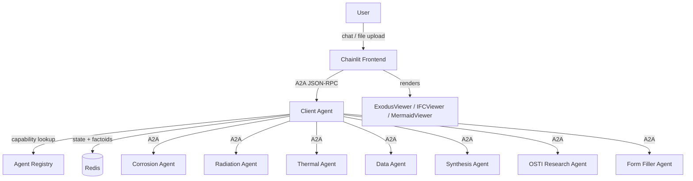

# Prometheus Platform

A multi-agent analysis platform for nuclear engineering. Users interact through a Chainlit chat UI that routes queries to specialist agents via a central client-agent orchestrator. The platform supports 3D visualization (Exodus, IFC), multi-step analysis workflows, persistent memory, and structured artifact management.

## Architecture



**Request flow:** User sends a message in Chainlit. The frontend forwards it as an A2A JSON-RPC request to the client-agent. The client-agent classifies the query, discovers relevant specialist agents from the registry, collects any missing parameters, builds an execution plan, and dispatches work. Results (including artifacts) flow back through the client-agent to the frontend for rendering.

## Prerequisites

- Python 3.13+
- [uv](https://docs.astral.sh/uv/) package manager
- Docker and Docker Compose (for multi-agent deployment)
- Redis (for memory and conversation state)

## Quickstart

### Option 1: Docker Compose (recommended)

```bash
# Copy and edit environment variables
cp .env.example .env
# Set: ANTHROPIC_API_KEY, AGENT_SECRET, REDIS_PASSWORD, REDIS_URL, CHAINLIT_AUTH_SECRET

# Put SSL cert into certs/
#   TODO - Update based on pulling inl certs. probably a way to do this with curl

# Sign into mooseharbor to pull prometheus_api container
docker login mooseharbor.hpc.inl.gov
# Username: HPC USERNAME
# Password: HPC PASSWORD

# Start all services
make up
```

Services start on:
- **Chainlit UI**: http://localhost:8500
- **Client Agent**: http://localhost:8001
- **LiteLLM agent gateway**: http://localhost:9977
- **Redis**: localhost:6379

### Option 2: Local development

```bash
# Install frontend dependencies
cd frontend && uv sync --group dev

# Start the frontend
make run
```

The Chainlit UI starts on the port shown in terminal output. Configure `config.yml` to point at a running client-agent instance.

### Log in

Default credentials (defined in `frontend/config.yml`):

- Username: `prometheus`
- Password: `prometheus`

## Key features

- **Multi-agent orchestration**: Client-agent dynamically routes queries to specialist agents (corrosion, radiation, thermal, data retrieval, synthesis, OSTI literature search)
- **3D visualization**: Upload and render Exodus II meshes (VTK.js) and IFC building models (ThatOpen/OBC) directly in the chat
- **Persistent memory**: Redis-backed factoid system extracts and recalls knowledge from past analyses
- **Artifacts**: Agents produce structured artifacts (JSON, files, references) tracked in a conversation-scoped registry
- **Workflow planning**: Multi-step analysis plans with user approval gates before execution
- **A2A protocol**: Standard Agent-to-Agent JSON-RPC 2.0 communication between all agents

## Configuration

The frontend reads `frontend/config.yml`:

| Key | Description |
|-----|-------------|
| `agent-url` | Client-agent A2A endpoint (default: `http://localhost:8001`). Overridden by `CLIENT_AGENT_URL` env var. |
| `agent-secret` | Bearer token for agent auth. Overridden by `AGENT_SECRET` env var. |
| `redis-url` | Redis connection URL for memory browsing. Overridden by `REDIS_URL` env var. |
| `debug` | Enable debug features in the UI settings panel |
| `auto-approve-steps` | Skip manual approval between workflow steps |
| `workflow-suggestions` | Chat suggestions shown on startup |
| `local-users` | Username/password pairs for local auth |

Override the config path with `PROMETHEUS_CONFIG_PATH=/path/to/config.yml`.

## Project structure

```
prometheus_platform/
  frontend/
    main.py               # Chainlit app entry point
    config.yml             # Application configuration
    components/            # Message handling, file processing, settings
    utils/                 # Settings loader, A2A client, memory client
    public/elements/       # Custom React components (JSX)
    public/js/             # Bundled JS for IFC and VTK viewers
    tests/

  agents/
    client-agent/          # LangGraph orchestrator
    corrosion-agent/       # Corrosion analysis specialist
    radiation-agent/       # Radiation damage specialist
    thermal-agent/         # Thermal analysis specialist
    data-agent/            # Material data retrieval
    synthesis-agent/       # Report synthesis
    osti-research-agent/   # OSTI literature search
    form-filler-agent/     # Dynamic form completion
    artifact-debug-agent/  # Testing/debug agent
    requirements-agent/    # Requirements extraction

  docker-compose.yml       # Full-stack deployment
  docs/                    # Project documentation
```

## Development

```bash
cd frontend

make run        # Start Chainlit
make test       # Run pytest
make lint       # Ruff linter
make format     # Ruff formatter check
make fix        # Auto-fix lint + format
make check      # All checks (lint + format + typecheck)
```

Run a single test:

```bash
uv run pytest tests/test_chat.py       # By file
uv run pytest -k test_name             # By name
```

## Documentation

- [Architecture](docs/architecture.md)
- [Adding agents](docs/adding-agents.md)
- [Memory system](docs/memory-system.md)
- [Artifacts](docs/artifacts.md)
- [Visualization plugins](docs/visualization-plugins.md)
- [Migration guide](docs/migration.md) -- what changed from the original projects and why
