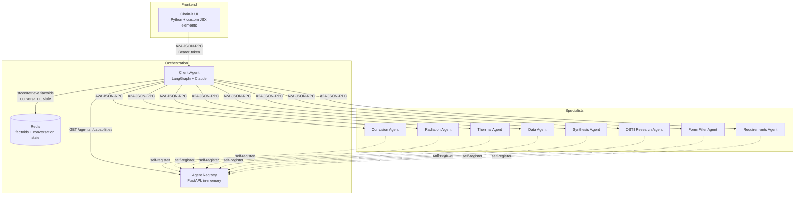
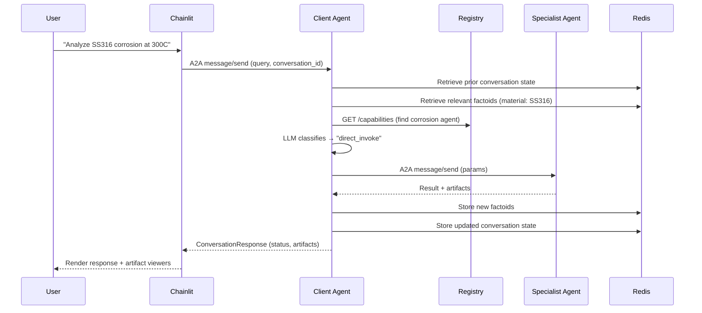

# Architecture

## System overview

Prometheus is a multi-agent platform for nuclear engineering analysis. A Chainlit chat frontend communicates with a central client-agent orchestrator, which dynamically routes queries to specialist agents using the A2A (Agent-to-Agent) JSON-RPC 2.0 protocol. Redis provides persistent memory and conversation state.

## Architecture diagram



## Component responsibilities

### Chainlit frontend

The frontend is a Python Chainlit application that provides:

- Chat interface with status polling during long-running agent calls
- File upload handling (Exodus, IFC, PDF) with local processing
- Custom React elements for visualization (ExodusViewer, IFCViewer, MermaidViewer, PlanViewer, MemoryCards)
- Authentication (password-based, OAuth-ready)
- Settings panel with agent toggles and debug tools
- Follow-up suggestion cards and DynamicForm for structured input
- Memory browser for viewing and managing Redis factoids

The frontend communicates with the client-agent via A2A JSON-RPC. During blocking A2A calls, the A2A client polls the agent's `/status/{conversation_id}` endpoint every 3 seconds and displays progress updates in a `cl.Step` element.

### Client-agent (orchestrator)

The client-agent is a LangGraph-based orchestrator that:

1. **Classifies queries** using LLM-based routing with capability metadata
2. **Discovers agents** from the registry's capability catalog
3. **Collects parameters** by asking follow-up questions when information is missing
4. **Builds execution plans** for multi-step analyses
5. **Manages approval gates** before executing plans
6. **Dispatches work** to specialist agents via A2A
7. **Extracts and stores factoids** in Redis for future recall
8. **Synthesizes results** from multiple agents into coherent responses

**Routing flow:**

```
understand_query → route_by_decision
    ├─ "fallback"        → fallback_response → END
    ├─ "direct_invoke"   → invoke_agent_generic → END
    ├─ "collect_params"  → ask_followup_dynamic → END
    └─ "plan_and_approve"→ plan → show_plan → [approval] → execute → END
```

### Agent registry

A lightweight FastAPI service (~220 lines) that provides:

- Agent registration and deregistration
- Agent card hosting (A2A discovery)
- Capability-based lookup (flattened skill catalog with input schemas)
- Heartbeat/liveness tracking

The registry uses in-memory storage. Agents self-register on startup.

**Why not litellm for registry?** litellm is a model routing proxy. It handles LLM provider abstraction, load balancing, and API key management -- but it has no concept of agent skills, input schemas, or capability-based routing. Use litellm for model proxying (all agents point at a single litellm instance for LLM calls). Keep the registry for agent discovery.

### Redis

Serves two purposes:

1. **Factoid storage**: Structured knowledge extracted from analyses, indexed by material and analysis type, with embedding vectors for semantic search
2. **Conversation state**: Multi-turn conversation state persistence (keyed by `conversation:{id}`)

### Specialist agents

Each specialist agent is a standalone container built on the `PrometheusAgent` base class from `prometheus_api`. Agents:

- Load metadata from `agent_card.json`
- Self-register with the registry on startup
- Accept A2A JSON-RPC requests with Bearer token auth
- Execute domain-specific analysis
- Return results as artifacts

Current specialists: corrosion, radiation, thermal, data retrieval, synthesis, OSTI literature search, form filler, requirements.

## Data flow for a typical request



## A2A protocol

All inter-agent communication uses JSON-RPC 2.0 over HTTP POST:

```json
{
  "jsonrpc": "2.0",
  "id": "request-uuid",
  "method": "message/send",
  "params": {
    "message": {
      "messageId": "msg-uuid",
      "role": "user",
      "parts": [{"type": "text", "text": "{\"query\": \"...\", \"conversation_id\": \"...\"}"}]
    },
    "configuration": {"blocking": true},
    "context": {"skillId": "analyze_corrosion", "conversationId": "conv-uuid"}
  }
}
```

Authentication uses Bearer tokens via the `Authorization` header, validated by `BearerTokenMiddleware` in the PrometheusAgent base class.

**Current limitation:** The client-agent uses blocking mode (`blocking: true`), meaning it waits for the full specialist agent response before returning. There is no real-time streaming from specialist agents to the frontend.

## LiteLLM integration

litellm should be deployed as a shared model proxy, not as a service registry. The recommended setup:

1. Deploy litellm proxy as a sidecar or shared service
2. Configure all agents to route LLM calls through litellm instead of creating direct `ChatAnthropic` instances
3. litellm handles model selection, fallback, rate limiting, and API key management

```yaml
# litellm config.yaml
model_list:
  - model_name: "claude-sonnet"
    litellm_params:
      model: "anthropic/claude-sonnet-4-20250514"
      api_key: "${ANTHROPIC_API_KEY}"
```

Agents call litellm's OpenAI-compatible endpoint instead of Anthropic directly. This centralizes model configuration and enables provider switching without agent changes.

## Deployment

All services are containerized via Docker Compose:

| Service | Container | Port | Role |
|---------|-----------|------|------|
| Registry | agent-registry | 8000 | Agent discovery |
| Client Agent | client-agent | 8001 | Orchestration |
| Corrosion Agent | corrosion-agent | 8002 | Specialist |
| Radiation Agent | radiation-agent | 8003 | Specialist |
| Thermal Agent | thermal-agent | 8004 | Specialist |
| Data Agent | data-agent | 8005 | Specialist |
| Form Filler | form-filler-agent | 8006 | Specialist |
| OSTI Research | osti-research-agent | 8007 | Specialist |
| Artifact Debug | artifact-debug-agent | 8008 | Testing |
| Synthesis Agent | synthesis-agent | 8009 | Specialist |
| Redis | agent-redis | 6379 | State/memory |
| Chainlit Frontend | chainlit-frontend | 8500 | UI |

All containers share the `agent-network` bridge network. Environment variables for secrets (`ANTHROPIC_API_KEY`, `AGENT_SECRET`, `REDIS_PASSWORD`) are passed via `.env` file.
