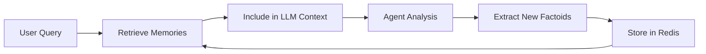

# Memory system

The memory system allows the client-agent to learn from past analyses and recall relevant information for future queries. It is backed by Redis and managed by the `MemoryManager` class in the client-agent.

## How factoids work

A **factoid** is a structured piece of knowledge extracted from a completed analysis. Each factoid contains:

```json
{
  "factoid_id": "uuid",
  "content": "SS316 shows 0.02mm/year corrosion rate at 300C in sodium coolant",
  "material_id": "SS316",
  "analysis_type": "corrosion",
  "embedding": [0.012, -0.034, ...],
  "created_at": "2026-03-13T10:00:00Z"
}
```

### Storage

Factoids are stored in Redis with three layers:

1. **Primary storage**: `factoid:{uuid}` -- Full JSON blob for each factoid
2. **Material index**: `material:{id}:factoids` -- Redis set mapping material IDs to factoid IDs
3. **Analysis type index**: `analysis_type:{type}:factoids` -- Redis set mapping analysis types to factoid IDs
4. **Embeddings index**: `embeddings:index` -- Redis sorted set of all factoid IDs with embeddings

### Retrieval

The client-agent retrieves memories at the start of each conversation turn:

1. **By material**: If the query mentions a material (e.g., "SS316"), fetch all factoids for that material via the material index
2. **By analysis type**: If the query involves a specific analysis type, fetch via the analysis type index
3. **By similarity**: Compute cosine similarity between the query embedding and stored factoid embeddings, return top-k matches above a similarity threshold (default: 0.7)

Retrieved memories are injected into the LLM context so the agent can reference past findings.

### Extraction

After an analysis completes, the client-agent extracts new factoids:

1. The LLM reviews the analysis results and conversation history
2. It identifies discrete facts worth remembering (material properties, analysis outcomes, design parameters)
3. Each fact is stored as a factoid with material/analysis type metadata and an embedding vector

## Conversation state

Multi-turn conversations are tracked in Redis at `conversation:{id}`:

```json
{
  "conversation_id": "uuid",
  "user_query": "Analyze SS316 corrosion...",
  "conversation_history": [...],
  "routing_decision": {"type": "direct_invoke", ...},
  "plan": null,
  "missing_info": [],
  "awaiting_approval": false,
  "tool_results": {},
  "retrieved_memories": [...],
  "extracted_factoids": [...],
  "num_memories_retrieved": 3,
  "num_memories_stored": 2
}
```

The client-agent loads conversation state at the start of each turn and saves it after processing. This enables multi-turn interactions (follow-up questions, plan approval, iterative refinement).

**Note:** Conversation state currently has no TTL. Add a 24-48 hour TTL to prevent unbounded Redis memory growth.

## Querying memory from the UI

Users can query the memory system through the chat interface:

- `/memory` -- List recent factoids
- `/memory SS316` -- List factoids for a specific material
- `/memory corrosion` -- List factoids by analysis type

These commands are handled by the client-agent's conversation router.

## Memory lifecycle



1. **Query arrives** -- Client-agent receives a user query
2. **Retrieve** -- Fetch relevant factoids by material, analysis type, and semantic similarity
3. **Contextualize** -- Include retrieved factoids in the LLM prompt as prior knowledge
4. **Analyze** -- Specialist agents produce results
5. **Extract** -- LLM identifies new facts from the results
6. **Store** -- New factoids are indexed in Redis with embeddings
7. **Available for next query** -- Future queries can retrieve these factoids

## Semantic search implementation

The current implementation computes cosine similarity in Python:

```python
def search_similar_factoids(self, query_embedding, material_id=None, top_k=5, min_similarity=0.7):
    # Load candidate factoids from Redis
    # Compute cosine similarity for each
    # Return top_k matches above threshold
```

This is O(n) in the number of factoids and will degrade at scale. The recommended upgrade path is to switch to Redis Stack with the RediSearch module, which provides native vector KNN search via `FT.SEARCH`. This requires:

1. Use the `redis/redis-stack` Docker image instead of `redis:7-alpine`
2. Create a RediSearch index with a vector field
3. Replace the Python cosine similarity loop with `FT.SEARCH ... KNN k`

## Frontend memory browser

The Chainlit frontend includes a `MemoryClient` (`frontend/utils/memory_client.py`) that connects to the same Redis instance as the client-agent. It provides read and delete access to factoids for UI display:

```python
from utils.memory_client import MemoryClient

client = MemoryClient(redis_url="redis://localhost:6379")

# Browse all factoids
factoids = client.get_all_factoids(limit=100)

# Filter by material
ss316_facts = client.get_factoids_by_material("SS316")

# Delete a factoid
client.delete_factoid(factoid_id="uuid")

# View conversation history
conversations = client.get_conversation_history(limit=20)
```

Factoids are rendered in the UI using the `MemoryCards.jsx` custom element. See [visualization-plugins.md](visualization-plugins.md#memorycards) for details.

## Configuration

| Variable | Default | Description |
|----------|---------|-------------|
| `REDIS_URL` | `redis://localhost:6379` | Redis connection URL (client-agent and frontend) |
| `REDIS_PASSWORD` | -- | Redis auth password |

The `MemoryManager` is instantiated as a singleton in the client-agent process. The frontend's `MemoryClient` is instantiated from the `redis-url` setting in `frontend/config.yml` (overridden by `REDIS_URL` env var).
