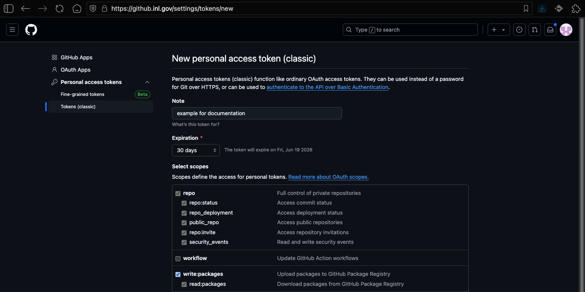

# Container Registry — github.inl.gov

Guide for authenticating and working with the GitHub Container Registry (GHCR) hosted on the INL GitHub Enterprise Server (GHES) instance.

- **Full registry prefix:** `containers.github.inl.gov/genesis`

## Create a Personal Access Token (PAT)

Create a new PAT at - https://github.inl.gov/settings/tokens/new

Set the following token scopes:

| Action | Required Scope |
|--------|---------------|
| Pull packages | `read:packages` |
| Push packages | `write:packages` |



## Authenticate with Registry

Log in to the registry before pushing or pulling private images. Store your token in an environment variable to avoid it appearing in shell history.

```bash
export GITHUB_PAT=<your-token>

echo $GITHUB_PAT | docker login containers.github.inl.gov \
  --username <your-github-username> \
  --password-stdin
```

A successful login returns:

```
Login Succeeded
```

To log out:

```bash
docker logout containers.github.inl.gov
```

## Pulling an Image

```bash
docker pull containers.github.inl.gov/genesis/<image-name>:<tag>
```


## Pushing an Image

### 1. Build or tag your image

Tag an existing local image so Docker knows which registry to push to:

```bash
docker tag <local-image>:<tag> containers.github.inl.gov/genesis/<image-name>:<tag>
```

Or build and tag in one step:

```bash
docker build -t containers.github.inl.gov/genesis/<image-name>:<tag> .
```

### 2. Push the image

```bash
docker push containers.github.inl.gov/genesis/<image-name>:<tag>
```

**Example — build and push:**

```bash
docker build -t github.inl.gov/genesis/myapp:1.0.0 .
docker push github.inl.gov/genesis/myapp:1.0.0

# Also tag and push as latest
docker tag github.inl.gov/genesis/myapp:1.0.0 github.inl.gov/genesis/myapp:latest
docker push github.inl.gov/genesis/myapp:latest
```